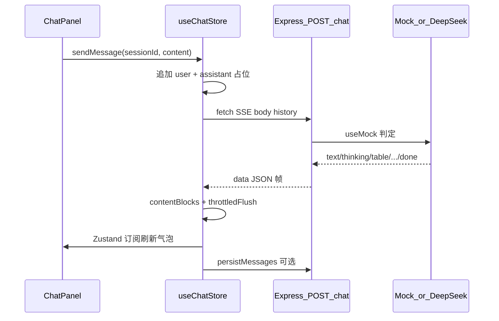
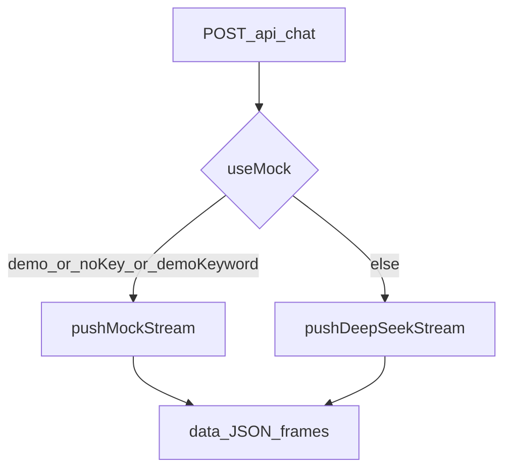
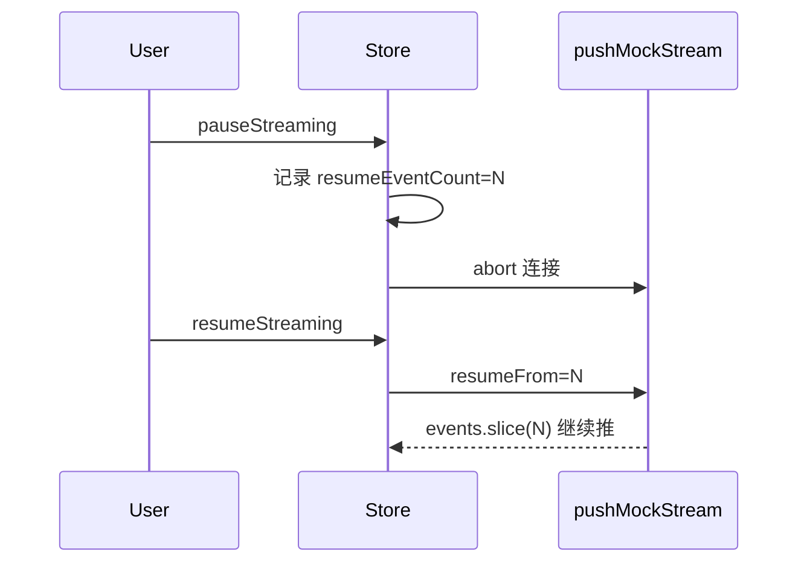

# AI 对话功能 — 代码详解（按功能点）

> 与仓库源码同步。面试速览见 [`AI对话功能-完整学习文档.md`](./AI对话功能-完整学习文档.md)；本文按**功能点**拆解，跟着代码走。  
> 入口页面：`/sbsjjc`（[`src/pages/sbsjjc/index.tsx`](src/pages/sbsjjc/index.tsx)）

每个功能点统一结构：**做什么 → 代码落点 → 关键实现 → 数据流 → 设计意图/边界**。

---

## 目录

1. [总览：一次完整请求怎么走](#1-总览一次完整请求怎么走)
2. [类型系统与 contentBlocks](#2-类型系统与-contentblocks)
3. [SSE 协议与双模式网关](#3-sse-协议与双模式网关)
4. [DeepSeek 真模型流](#4-deepseek-真模型流)
5. [Mock 结构化演示流](#5-mock-结构化演示流)
6. [Store：多会话与 AbortController Map](#6-store多会话与-abortcontroller-map)
7. [发消息与流式解析循环](#7-发消息与流式解析循环)
8. [停止 / 暂停 / 继续](#8-停止--暂停--继续)
9. [会话侧栏与草稿](#9-会话侧栏与草稿)
10. [消息渲染分发](#10-消息渲染分发)
11. [思考过程 / 表格 / 图表 / Markdown](#11-思考过程--表格--图表--markdown)
12. [虚拟列表与滚动](#12-虚拟列表与滚动)
13. [教育快捷意图](#13-教育快捷意图)
14. [持久化与降级](#14-持久化与降级)
15. [附录：文件索引与已知边界](#15-附录文件索引与已知边界)

---

## 1. 总览：一次完整请求怎么走

### 这个功能做什么

用户在输入框打字点「发送」后，界面立刻出现用户气泡和空的 AI 气泡；AI 内容以「打字机」方式一点一点长出来（或先出思考过程，再出表格/图表）。

### 代码落点

| 层级 | 文件 | 关键符号 |
|------|------|----------|
| 页面壳 | `src/pages/sbsjjc/index.tsx` | `initStore` + `SessionSidebar` + `ChatPanel` |
| 输入/发送 | `src/components/Chat/ChatPanel.tsx` | `handleSend` |
| 状态机 | `src/store/useChatStore.ts` | `sendMessage` |
| 网关 | `react-node/src/routes/chat.ts` | `POST /` |
| 真模型 / mock | `deepseekService.ts` / `aiService.ts` | `streamDeepSeekChat` / `generateStream` |

### 关键实现

页面只做挂载：

```7:26:src/pages/sbsjjc/index.tsx
const Sbsjjc: React.FC = () => {
  const sessions = useChatStore((s) => s.sessions);
  const initStore = useChatStore((s) => s.initStore);
  const initializedRef = useRef(false);

  useEffect(() => {
    if (initializedRef.current) return;
    initializedRef.current = true;
    if (sessions.length === 0) {
      initStore();
    }
  }, [sessions.length, initStore]);

  return (
    <div className="sbsjjc-chat">
      <SessionSidebar />
      <ChatPanel />
    </div>
  );
};
```

`ChatPanel.handleSend` 不清空逻辑本身，只把当前会话的 `draftInput` 交给 Store，并立刻清空草稿：

```79:83:src/components/Chat/ChatPanel.tsx
  const handleSend = useCallback(() => {
    if (!activeSessionId || !inputValue.trim() || isStreaming) return;
    sendMessage(activeSessionId, inputValue);
    setDraftInput(activeSessionId, "");
  }, [activeSessionId, inputValue, isStreaming, sendMessage, setDraftInput]);
```

真正的协议与状态更新全在 `sendMessage`（见第 7 节）。

### 数据流



### 设计意图 / 边界

- UI 不直接 `fetch`；所有流式读写进 Store，换会话时后台流仍能写回对应 `sessionId`。
- 传输是 **`fetch` + `ReadableStream`**，不是 `EventSource`，也不是 WebSocket（POST body 要带 `history`/`resumeFrom`，EventSource 只能 GET）。

**可怎么讲：** 端到端是「UI 发意图 → Store 吃协议 → 后端做双模式网关 → 再写回 contentBlocks」。

---

## 2. 类型系统与 contentBlocks

### 这个功能做什么

同一条 AI 回复里可以按顺序出现：Markdown 文本、表格、图表；思考过程单独挂在消息上。传输层用 SSE 事件，渲染层用 `contentBlocks`。

### 代码落点

- [`src/types/chat.ts`](src/types/chat.ts)：前端权威类型
- [`react-node/src/services/aiService.ts`](react-node/src/services/aiService.ts)：后端 SSE 事件联合类型（形状对齐）

### 关键实现

**三层模型：**

1. **传输层** `SSEEventType`：`thinking` | `text` | `table_loading` | `table_data` | `chart_loading` | `chart_data` | `data_chunk` | `done`
2. **渲染层** `MessageContent`：`text` | `table` | `chart`
3. **会话层** `ChatSession`：messages + 流式元数据（`isStreaming`、`draftInput`、`isPaused`、`resumeEventCount` 等）

内容块联合类型：

```18:53:src/types/chat.ts
export interface TextContent {
  type: 'text';
  text: string;
}
// ...
export interface TableContent {
  type: 'table';
  columns: TableColumn[];
  data: Record<string, any>[];
  title?: string;
}
// ...
export interface ChartContent {
  type: 'chart';
  chartType: 'bar' | 'line' | 'pie' | 'scatter';
  title?: string;
  config: Record<string, any>;
}

export type MessageContent =
  | TextContent
  | TableContent
  | ChartContent;
```

消息同时保留 `content: string`（纯文本拼接）和 `contentBlocks`：

```59:69:src/types/chat.ts
export interface ChatMessage {
  id: string;
  role: MessageRole;
  content: string; // 兼容旧版纯文本
  contentBlocks?: MessageContent[];
  isStreaming?: boolean;
  thinkingStages?: ThinkingStage[];
  createdAt?: number;
}
```

`flushMessages` 每次 flush 时会用所有 text block 拼回 `content`，供多轮 `history` 使用：

```351:354:src/store/useChatStore.ts
            content: contentBlocks
              .filter((b): b is TextContent => b.type === "text")
              .map((b) => b.text)
              .join(""),
```

### 数据流

```
SSE event.type ──switch──► 改 contentBlocks / thinkingStages
                              │
                              ▼
                         flushMessages
                              │
                              ▼
                    ChatMessageItem 按 block.type 分发 Renderer
```

`data_chunk` 不单独成为 block 类型：它通过 `blockId` + `index` **增量合并**进已有的 table/chart block（见第 7 节 `handleDataChunk`）。

### 设计意图 / 边界

- 不用「全塞进一个 Markdown 字符串再硬解析」——表格/图表是一等公民。
- 扩展新块：加 SSE type → Store 解析 → 新 Renderer；协议与 UI 同步演进。
- DeepSeek 路径目前只产出 `text` + `done`，不会自动生成 table/chart blocks。

**可怎么讲：** 传输是事件，渲染是 contentBlocks，会话是带流式元数据的 Session——三层解耦。

---

## 3. SSE 协议与双模式网关

### 这个功能做什么

浏览器 `POST /api/chat`，服务端以 `text/event-stream` 持续推送 `data: {JSON}\n\n`。根据密钥与消息内容，走 **mock 结构化流** 或 **DeepSeek 真模型流**。

### 代码落点

- [`react-node/src/routes/chat.ts`](react-node/src/routes/chat.ts)：网关
- [`react-node/src/index.ts`](react-node/src/index.ts)：挂载路由、CORS、`/api/health`

### 关键实现

**请求体字段：**

| 字段 | 用途 |
|------|------|
| `message` | 当前用户输入（必填） |
| `sessionId` | 日志/关联（可选） |
| `history` | `{ role, content }[]`，DeepSeek 多轮 |
| `demo` | `true` 强制 mock |
| `resumeFrom` | mock 续传：跳过前 N 个事件 |

**双模式判定：**

```189:193:react-node/src/routes/chat.ts
  const useMock =
    demo === true ||
    !hasDeepSeekKey() ||
    isMockDemoMessage(trimmed);
```

**SSE 头与推送：**

```20:58:react-node/src/routes/chat.ts
function setupSseHeaders(req: Request, res: Response): void {
  res.status(200);
  res.set('Content-Type', 'text/event-stream; charset=utf-8');
  res.set('Cache-Control', 'no-cache');
  // ...
}
// createSseReadable → readable.push(`data: ${JSON.stringify(event)}\n\n`)
```

**客户端中止：**

```198:206:react-node/src/routes/chat.ts
  req.on('aborted', () => {
    aborted = true;
    upstreamAbort.abort();
    readable.destroy();
  });
```

前端 abort → 连接断开 → `req.aborted` → DeepSeek 的 `fetch` 也被 `upstreamAbort.signal` 掐断。

### 数据流



### 设计意图 / 边界

- 用 JSON SSE 而不是纯文本：同一连接要混 thinking / table / chart 元数据；前端靠 `type` 分发。
- 非 JSON 行：mock 可故意注入原始字符串做容错测试；前端 `JSON.parse` 失败则当纯文本追加（见第 7 节）。
- **DeepSeek 路径明确不支持 `resumeFrom`**（注释写在路由里）。

**可怎么讲：** 后端是协议网关——对上统一 SSE，对下可换 mock 或 DeepSeek，密钥不出浏览器。

---

## 4. DeepSeek 真模型流

### 这个功能做什么

配置了 `DEEPSEEK_API_KEY` 且消息不是演示关键词时，真正调用 DeepSeek Chat Completions（OpenAI 兼容、`stream: true`），把 `delta.content` 映射成前端已认识的 `text` 事件。

### 代码落点

- [`react-node/src/services/deepseekService.ts`](react-node/src/services/deepseekService.ts)：`streamDeepSeekChat`、`hasDeepSeekKey`、`normalizeHistory`
- 路由侧：`pushDeepSeekStream`

### 关键实现

**消息拼装：** system（教育向 Prompt，可被环境变量覆盖）+ 最近 20 条 history + 当前 user：

```72:81:react-node/src/services/deepseekService.ts
    body: JSON.stringify({
      model,
      messages: [
        { role: 'system', content: resolveSystemPrompt() },
        ...prior,
        { role: 'user', content: message },
      ],
      stream: true,
    }),
```

**上游 SSE → 本项目 SSE：**

```120:127:react-node/src/services/deepseekService.ts
          const content = json.choices?.[0]?.delta?.content;
          if (content) {
            yield { type: 'text', data: { content } };
          }
```

收到上游 `[DONE]` 或流结束时 yield `{ type: 'done' }`。

**失败降级**（路由层）：推一条错误 `text` + `done`，前端仍能显示在气泡里。

前端 history 在写入本轮消息**之前**截取：

```31:41:src/store/useChatStore.ts
function buildChatHistory(messages: ChatMessage[]): ChatHistoryItem[] {
  return messages
    .filter(
      (m) =>
        (m.role === "user" || m.role === "assistant") &&
        Boolean(m.content?.trim()) &&
        !m.isStreaming,
    )
    .slice(-CHAT_HISTORY_LIMIT)
    .map((m) => ({ role: m.role, content: m.content.trim() }));
}
```

注意：history 用的是 `content` 纯文本（表格/图不会进 LLM 上下文）。

### 设计意图 / 边界

- Key 只在服务端；前端只打自己的 `/api/chat`。
- 真模型只保证「能聊」；结构化表格/图表演示交给 mock。
- 暂停续传对 DeepSeek **无效**（无法按事件下标跳过上游 token）。

**可怎么讲：** 多轮 = 前端 `buildChatHistory` + 后端 system Prompt + stream delta 映射。

---

## 5. Mock 结构化演示流

### 这个功能做什么

无 Key、强制 `demo`、或命中演示关键词时，本地生成「思考 → 文本 → 表格/图表 → done」事件序列，按延迟逐帧推送，方便作品集演示与边界测试。

### 代码落点

- [`aiService.ts`](react-node/src/services/aiService.ts)：`generateStream`、`isMockDemoMessage`
- [`chat.ts`](react-node/src/routes/chat.ts)：`pushMockStream`（sleep + `resumeFrom` 切片）

### 关键实现

**关键词判定**（有 Key 时仍可走 mock）：

```704:718:react-node/src/services/aiService.ts
export function isMockDemoMessage(message: string): boolean {
  // 中断 markdown / 异常数据 / loading 中断 / json 容错 /
  // 逐行 chunk / markdown / 分析销售数据 / 图表 / 对比 / 表格 ...
  return false; // 以上任一命中则 true
}
```

**按关键词选流：** 边界测试优先，然后「分析销售数据」走完整 `generateDemoFlow`，否则图表/表格/简单 Markdown 等。

**推送节奏：** thinking ~600ms，loading ~800ms，中文 text ~50ms/token，`data_chunk` ~400ms——模拟真实感。

**续传：**

```71:73:react-node/src/routes/chat.ts
  const allEvents = generateStream(message);
  const events =
    resumeFrom && resumeFrom > 0 ? allEvents.slice(resumeFrom) : allEvents;
```

mock 事件数组可随机访问，所以能按下标跳过；DeepSeek 做不到这一点。

**常用演示词：**

| 输入关键词 | 效果 |
|------------|------|
| `分析销售数据` | 完整报告：思考 + Markdown + 表 + 图 |
| `图表` / `趋势` | 多图 |
| `逐行` / `chunk` | `data_chunk` 逐行/逐系列 |
| `中断 markdown` | 未闭合围栏，测 sanitize |
| `json 容错` | 注入非 JSON 行 |

### 设计意图 / 边界

- 面试叙事：「会判断 AI 边界」——模型不会稳定吐 ECharts JSON，所以结构化演示用 mock。
- `generateStream` 返回的是**完整事件数组**，再由路由 sleep 推送；不是真的异步生成器对上游拉流（DeepSeek 才是）。

---

## 6. Store：多会话与 AbortController Map

### 这个功能做什么

多个会话并行：切到 B 时，A 的流仍在后台收包并写回 A；侧栏可看到「正在回答」并单独停止。

### 代码落点

- [`src/store/useChatStore.ts`](src/store/useChatStore.ts) 模块级闭包 + Zustand state

### 关键实现

**不可序列化的连接态放模块级 Map**（不进 Zustand，避免被 persist/devtools 搞坏）：

```43:50:src/store/useChatStore.ts
const abortControllers = new Map<string, AbortController>();
const resumeEventCounts = new Map<string, number>();
const streamEventCounts = new Map<string, number>();
```

**视图指针 vs 连接：**

| 概念 | 存放 | 作用 |
|------|------|------|
| `activeSessionId` | Zustand | 只决定渲染哪套 messages / draft |
| `abortControllers.get(id)` | 模块 Map | 该会话的物理 SSE 连接 |
| `sessions[].isStreaming` | Zustand | UI 指示器（侧栏转圈、输入禁用） |

切换会话：

```308:316:src/store/useChatStore.ts
  setActiveSession: (id: string) => {
    set({ activeSessionId: id });
    const session = get().getSession(id);
    if (session && session.messages.length === 0 && !session.isStreaming) {
      get().loadMessages(id);
    }
  },
```

只改指针；**不会** abort 其他会话的 controller。

删除会话会先 abort 再删：

```267:273:src/store/useChatStore.ts
    const ctrl = abortControllers.get(id);
    if (ctrl) {
      ctrl.abort();
      abortControllers.delete(id);
    }
```

### 数据流

```
Session A 发消息 → Map.set(A, controllerA) → SSE 循环写 sessions[A]
用户切到 B       → activeSessionId = B     → UI 显示 B
A 的 reader 仍在 → flushMessages(A, ...)   → 侧栏 A 仍显示 isStreaming
```

### 设计意图 / 边界

- 多会话本质是「连接与状态按 id 隔离，UI 只是订阅器」。
- 刷新页面：`initStore` 拉会话/消息；**进行中的 SSE 不会跨刷新恢复**（需重新发或对 mock 用暂停状态续传）。

**可怎么讲：** AbortController Map + 按 sessionId 写入 = 切换不中断。

---

## 7. 发消息与流式解析循环

### 这个功能做什么

从点发送到气泡内容变完整：乐观插入、拉 SSE、拆帧、按事件类型改 blocks、节流 flush、失败重连、结束持久化。

### 代码落点

- `useChatStore.sendMessage`（约 390–766 行）
- `flushMessages`、`throttledFlush`、`handleDataChunk`

### 关键实现（逐步）

**Step 1 — 截历史 + 乐观 UI**

```395:426:src/store/useChatStore.ts
    const history = buildChatHistory(session.messages);
    // 追加 userMsg + assistantMsg(isStreaming: true, contentBlocks: [])
```

必须在追加前截 history，否则会把「正在生成的空 assistant」或本轮 user 错误带进上下文。

**Step 2 — 每会话 AbortController + 最多 3 次重连**

```428:476:src/store/useChatStore.ts
    const MAX_RETRIES = 3;
    const RETRY_DELAYS = [1000, 2000, 4000];
    // attempt>0 时清空局部 blocks，显示「连接断开，正在重连」
    const controller = new AbortController();
    abortControllers.set(sessionId, controller);
```

`AbortError`（用户停止）直接 break，不重试。

**Step 3 — 读流、按 `\n\n` 拆 SSE 事件**

```575:583:src/store/useChatStore.ts
          lineBuffer += chunk;
          const events = lineBuffer.split("\n\n");
          lineBuffer = events.pop() || "";
```

半包留在 `lineBuffer`；完整事件再按行找 `data: ` 前缀。

**Step 4 — `switch(event.type)` 核心映射**

| 事件 | Store 行为 |
|------|------------|
| `thinking` | `thinkingStages.push` |
| `text` | 若末块是 text 则拼接，否则 push 新 text block |
| `table_loading` / `chart_loading` | 记 `pendingLoadingBlock`（UI 侧主要靠 isStreaming + 空数据出骨架） |
| `table_data` / `chart_data` | 转成 `handleDataChunk(..., index: 0)` 一次性建块 |
| `data_chunk` | `blockId` 映射下标；index===0 建块，否则追加 rows/series |
| `done` | 计数；循环靠 reader `done` 结束 |
| JSON 解析失败 | 整段 payload 当 text 追加（容错） |

**text 合并示例：**

```613:625:src/store/useChatStore.ts
                  case "text": {
                    const textContent = event.data.content as string;
                    const lastBlock = contentBlocks[contentBlocks.length - 1];
                    if (lastBlock && lastBlock.type === "text") {
                      contentBlocks[contentBlocks.length - 1] = {
                        type: "text",
                        text: (lastBlock as TextContent).text + textContent,
                      };
                    } else {
                      contentBlocks.push({ type: "text", text: textContent });
                    }
```

**chunk 合并（表格）：**

```496:514:src/store/useChatStore.ts
        if (chunk.chunkType === "table") {
          if (chunk.index === 0) {
            blockIdMap.set(chunk.blockId, contentBlocks.length);
            contentBlocks.push({ type: "table", columns, data: rows, title });
          } else {
            const idx = blockIdMap.get(chunk.blockId);
            // data: [...block.data, ...chunk.rows]
          }
        }
```

**Step 5 — 节流 flush（约 33ms ≈ 30fps）**

```481:489:src/store/useChatStore.ts
      const throttledFlush = () => {
        const now = Date.now();
        if (now - lastFlushTime >= FLUSH_INTERVAL_MS) {
          get().flushMessages(sessionId, localId, contentBlocks, thinkingStages, true);
        } else {
          pendingFlush = true;
        }
      };
```

高频 token 不会每个都 `set`，减少 React 重渲染；结束前若 `pendingFlush` 再刷一次。

**Step 6 — 结束**

```760:765:src/store/useChatStore.ts
      get().flushMessages(..., false); // isStreaming=false
      get().persistMessages(sessionId);
```

### 设计意图 / 边界

- `flushMessages` 默认假设 assistant 是 messages 最后一条（sendMessage 保证）；破坏时 findIndex 兜底。
- 重连会**清空**已积累的 contentBlocks 再来——适合断线，不适合「暂停续传」（暂停用另一套 `resumeStreaming`）。

**可怎么讲：** 流式难点不在显示字，而在半包拆帧、节流更新、错包降级、按 session 写回。

---

## 8. 停止 / 暂停 / 继续

### 这个功能做什么

- **停止**：掐断连接，当前已显示内容保留，不可「继续」同一条流。
- **暂停**：掐断连接，标记 `isPaused`，记住已消费事件数与原问题，可点「继续生成」。
- **继续**：带 `resumeFrom` 再请求（主要对 mock 有效）。

### 代码落点

- Store：`stopStreaming` / `pauseStreaming` / `resumeStreaming`
- UI：`ChatPanel` 底部按钮；`ChatMessageItem` 末条「继续生成」
- API：`PATCH /sessions/:id/pause`

### 关键实现

**停止：**

```1039:1059:src/store/useChatStore.ts
  stopStreaming: (sessionId: string) => {
    ctrl?.abort();
    // 清 Map 计数；isStreaming=false；isPaused=false
    persistMessages + updatePauseStateAPI(清除暂停)
  },
```

**暂停：**

```768:801:src/store/useChatStore.ts
  pauseStreaming: (sessionId: string) => {
    const count = streamEventCounts.get(sessionId) || 0;
    resumeEventCounts.set(sessionId, count);
    ctrl.abort();
    // isPaused: true, pausedMessage: 某条 user content
    persistMessages + updatePauseStateAPI({ resumeEventCount: count })
  },
```

`streamEventCounts` 在 SSE `switch` 里每处理一个有效事件就 `+1`，与 mock 数组下标对齐。

**继续：**

```818:924:src/store/useChatStore.ts
    // 从 lastMsg 拷贝已有 contentBlocks / thinkingStages
    const resumeFrom = resumeEventCounts.get(sessionId) || session.resumeEventCount || 0;
    fetch(..., body: { message: pausedMessage, sessionId, resumeFrom })
    // 继续往同一 localId 的 blocks 上追加
```

注意：`resumeStreaming` **不带 history**（mock 续传不需要多轮）；且从已有 blocks 继续追加，不会再插一条新 user/assistant。

### 数据流



### 设计意图 / 边界

- **DeepSeek 暂停后续传没有事件级语义**：再请求会从头生成，且当前 `resumeStreaming` 仍会把旧 blocks 留下来再往后接——真模型场景下体验不完整，代码注释已标明 mock 导向。
- `pauseStreaming` 用 `messages.find` 找**第一条** user 消息作为 `pausedMessage`，多轮会话里可能不是「触发本轮流」的那句——已知边界。

**可怎么讲：** 停止 = abort；暂停 = abort + 事件游标；继续 = mock 数组切片。

---

## 9. 会话侧栏与草稿

### 这个功能做什么

左侧管理多会话：新建、切换、双击重命名、删除（二次确认）、后台流停止；每个会话独立输入草稿，切换不丢。

### 代码落点

- [`SessionSidebar.tsx`](src/components/Chat/SessionSidebar.tsx)
- Store：`createSession` / `deleteSession` / `renameSession` / `setDraftInput`

### 关键实现

- `SessionItem` 用 `React.memo` 隔离；流式中非当前会话显示 ⏹，调用 `stopStreaming(id)`。
- 草稿存在 `session.draftInput`，输入框受控：

```120:126:src/components/Chat/ChatPanel.tsx
  const handleInputChange = useCallback(
    (e: React.ChangeEvent<HTMLInputElement>) => {
      if (activeSessionId) {
        setDraftInput(activeSessionId, e.target.value);
      }
    },
    [activeSessionId, setDraftInput],
  );
```

- 创建：本地生成 id → 尽量 `createSessionAPI` → 写入 sessions 并设为 active。
- 重命名：先乐观改本地，再 `PATCH` 后端。

### 设计意图 / 边界

- 草稿只在内存（随会话对象）；刷新后若从后端拉会话，`draftInput` 会重置为空（`fetchSessions` 映射里写死 `draftInput: ""`）。

---

## 10. 消息渲染分发

### 这个功能做什么

把一条 `ChatMessage` 画成气泡：用户纯文本；助手先思考过程，再按 contentBlocks 顺序渲染。

### 代码落点

- [`ChatMessageItem.tsx`](src/components/Chat/ChatMessageItem.tsx)

### 关键实现

```21:52:src/components/Chat/ChatMessageItem.tsx
const ContentBlockRenderer = ({ block, isLoading }) => {
  switch (block.type) {
    case "text": return <MarkdownRenderer ... />;
    case "table": return <DataTableRenderer ... />;
    case "chart": return <DataChartRenderer ... />;
  }
};
```

**自定义 memo 比较**很重要：chunk 追加行时 block **数量不变**，只变 `data.length` / `series.length`，默认浅比较会漏更新：

```141:162:src/components/Chat/ChatMessageItem.tsx
    // 当 data_chunk 追加行/系列时，block 数量不变但内部数据变了
    if (pb.type === "table") {
      if (pt.data?.length !== nt.data?.length) return false;
    }
    if (pb.type === "chart") {
      if (psLen !== nsLen) return false;
    }
```

暂停时在**最后一条**助手消息下显示「继续生成」。

### 设计意图 / 边界

- Store 吃协议，组件吃 contentBlocks；组件不关心 DeepSeek 还是 mock。

---

## 11. 思考过程 / 表格 / 图表 / Markdown

### 11.1 思考过程 `ThinkingProcess`

**做什么：** 展示 analyzing → searching → … → done 阶段列表，可折叠；流式时高亮当前阶段。

**落点：** [`ThinkingProcess.tsx`](src/components/Chat/ThinkingProcess.tsx)；数据来自 `thinking` SSE → `thinkingStages`。

**边界：** 真 DeepSeek 路径不发 thinking；只有 mock（或你将来扩展）才会有。

---

### 11.2 表格 `DataTableRenderer`

**做什么：** Ant Design Table；loading 时骨架屏；chunk 模式下有行数据就立刻 `ready` 并随 rows 增长。

**落点：** [`DataTableRenderer.tsx`](src/components/Chat/DataTableRenderer.tsx)

**关键点：**

- `isLoading && data.length===0` → skeleton
- 数据残缺时显示「表格数据不完整」，不抛崩

---

### 11.3 图表 `DataChartRenderer`

**做什么：** ECharts 按需 `echarts.use([...])`；skeleton → 出图；chunk 追加 series 时靠 `option` 更新。

**落点：** [`DataChartRenderer.tsx`](src/components/Chat/DataChartRenderer.tsx)

**关键点：**

```113:119:src/components/Chat/DataChartRenderer.tsx
          <ReactECharts
            option={data.config}
            notMerge={false}
            lazyUpdate
```

`notMerge={false}` 表示与旧 option 合并，适合 series 增量追加；若改成整表替换策略需重新评估。

---

### 11.4 Markdown + 流式修补

**做什么：** GFM + LaTeX(KaTeX) + 代码高亮；流式时未闭合的 \`\`\` / `$$` / `$` 先补全再渲染，避免 rehype 崩；流式光标闪烁。

**落点：**

- [`MarkdownRenderer.tsx`](src/components/Chat/MarkdownRenderer.tsx)
- [`sanitizeStreamingMarkdown.ts`](src/utils/sanitizeStreamingMarkdown.ts)
- [`CodeBlock.tsx`](src/components/Chat/CodeBlock.tsx)（复制按钮）
- [`ErrorBoundary.tsx`](src/components/Chat/ErrorBoundary.tsx)（渲染失败回退纯文本）

**修补逻辑：**

```5:29:src/utils/sanitizeStreamingMarkdown.ts
export function sanitizeStreamingMarkdown(text: string): string {
  // 奇数个 ``` → 补 \n```
  // 奇数个 $$ → 补 $$
  // 奇数个行内 $ → 补 $
  return safe;
}
```

只在渲染前临时补全，**不写回** Store 里的原始 content（流结束后真实文本应是闭合的；中断测试词除外）。

**可怎么讲：** 流式 Markdown 会炸是因为半包围栏；sanitize + ErrorBoundary 双保险。

---

## 12. 虚拟列表与滚动

### 这个功能做什么

长会话只渲染可视区附近消息；贴底时自动跟随输出；上翻时不强制跳回底部；支持「加载更早的消息」并保持滚动锚点。

### 代码落点

- [`ChatPanel.tsx`](src/components/Chat/ChatPanel.tsx)：`Virtuoso`
- Store：`loadMoreMessages`（pageSize 10，旧消息 prepend）

### 关键实现

```188:205:src/components/Chat/ChatPanel.tsx
          <Virtuoso
            key={activeSessionId}
            data={messages}
            firstItemIndex={firstItemIndex}
            followOutput={atBottom ? "smooth" : false}
            atBottomStateChange={setAtBottom}
            computeItemKey={(_index, msg) => msg.id}
            increaseViewportBy={{ top: 400, bottom: 400 }}
```

加载更早：

```71:77:src/components/Chat/ChatPanel.tsx
    const addedCount = await loadMoreMessages(activeSessionId);
    if (addedCount > 0) {
      setFirstItemIndex((prev) => prev - addedCount);
    }
```

`firstItemIndex` 减小后，Virtuoso 用「前置索引」保持当前视口内容不跳。

非贴底时显示 [`ScrollToBottomButton`](src/components/Chat/ScrollToBottomButton.tsx)。

### 设计意图 / 边界

- `key={activeSessionId}`：切会话重置列表内部状态。
- 流式追加 + `followOutput` 是选 Virtuoso 的主要原因。

---

## 13. 教育快捷意图

### 这个功能做什么

空会话时三个按钮：把预设 Prompt 填进草稿，用户可改完再发；不另开接口。

### 代码落点

```9:26:src/components/Chat/ChatPanel.tsx
const QUICK_ACTIONS = [
  { label: "讲解这道错题", prompt: "..." },
  { label: "推荐 3 道同类练习", prompt: "..." },
  { label: "改成学生能懂的讲解", prompt: "..." },
];
```

`handleQuickAction` → `setDraftInput(sessionId, prompt)`。

后端教育向 System Prompt 在 `deepseekService.ts` 的 `DEFAULT_EDU_SYSTEM_PROMPT`（启发思考、拒绝对整题代写等）。

### 设计意图 / 边界

- 对齐「推荐 / 生成类交互」叙事；仍走同一套 SSE。
- 快捷入口只改用户意图文本，不改协议。

---

## 14. 持久化与降级

### 这个功能做什么

有 MySQL 时：会话 CRUD、消息整表覆盖保存、暂停状态字段；没有库或 API 失败时，前端仍可本地聊（内存会话）。

### 代码落点

| 层 | 文件 |
|----|------|
| 前端 API | [`src/api/chat.ts`](src/api/chat.ts) |
| 路由 | [`react-node/src/routes/sessions.ts`](react-node/src/routes/sessions.ts) |
| DB | [`react-node/src/db.ts`](react-node/src/db.ts) 库 `cms_chat` |
| 入口降级 | `index.ts` 里 `initDB()` 失败仍启动服务 |

### 关键实现

**API_BASE：**

```3:6:src/api/chat.ts
export const API_BASE =
  import.meta.env.VITE_API_BASE?.trim().replace(/\/$/, "") || "/api";
```

本地 Vite 代理 `/api` → `localhost:3001`；生产用 Render 绝对地址。

**消息保存：** `POST /sessions/:id/messages` 覆盖该会话全部消息（含 `contentBlocks` / `thinkingStages` JSON）。

**initStore 降级：**

```136:157:src/store/useChatStore.ts
    } catch (err) {
      // 本地创建一个空会话，不依赖后端
    }
```

**表结构要点：** `sessions`（含 pause 三列）+ `messages`（FK CASCADE 删除）。

### 设计意图 / 边界

- 持久化失败只 `console.error`，不打断流式体验。
- 刷新可恢复历史消息；**不能**恢复进行中的 SSE 连接（暂停状态字段是为 mock 续传准备的）。

---

## 15. 附录：文件索引与已知边界

### 15.1 文件索引

| 主题 | 路径 |
|------|------|
| 页面入口 | `src/pages/sbsjjc/index.tsx` |
| 类型 | `src/types/chat.ts` |
| Store / SSE 循环 | `src/store/useChatStore.ts` |
| REST 客户端 | `src/api/chat.ts` |
| 面板 / 快捷入口 / Virtuoso | `src/components/Chat/ChatPanel.tsx` |
| 侧栏 | `src/components/Chat/SessionSidebar.tsx` |
| 气泡分发 | `src/components/Chat/ChatMessageItem.tsx` |
| Markdown / 表 / 图 / 思考 | `MarkdownRenderer` / `DataTableRenderer` / `DataChartRenderer` / `ThinkingProcess` |
| 流式 MD 修补 | `src/utils/sanitizeStreamingMarkdown.ts` |
| 聊天 SSE 网关 | `react-node/src/routes/chat.ts` |
| 会话 API | `react-node/src/routes/sessions.ts` |
| DeepSeek | `react-node/src/services/deepseekService.ts` |
| Mock | `react-node/src/services/aiService.ts` |
| 静态路由 | `src/router/index.tsx` → `sbsjjc` |
| 面试速览 | [`AI对话功能-完整学习文档.md`](./AI对话功能-完整学习文档.md) |

### 15.2 已实现 vs 未实现

| 能力 | 状态 |
|------|------|
| SSE 流式（fetch ReadableStream） | 已实现 |
| 多会话 + AbortController Map | 已实现 |
| 停止 / 暂停 / mock 续传 | 已实现 |
| DeepSeek 多轮 + 教育 Prompt | 已实现 |
| mock 思考/表/图/chunk | 已实现 |
| Virtuoso + 分页加载更早 | 已实现 |
| MySQL 可选持久化 | 已实现 |
| **Regenerate 重新生成** | **未实现** |
| **WebSocket / EventSource** | **未使用** |
| **`useStreamMessage` hook** | **存在但未接入产品路径**（教学用简化版；生产全在 Store） |
| DeepSeek 事件级 resume | **不支持** |

### 15.3 阅读建议（自学顺序）

1. `types/chat.ts` — 建立词汇表  
2. `routes/chat.ts` + `deepseekService` / `aiService` — 协议从哪来  
3. `useChatStore.sendMessage` — 前端如何吃协议  
4. `ChatPanel` + `ChatMessageItem` + 各 Renderer — 如何画出来  
5. `pauseStreaming` / `resumeStreaming` — 进阶控制流  

### 15.4 本地快速验证

```powershell
# 前端
pnpm dev
# http://localhost:5173/?token=dev → /sbsjjc

# 后端（另开终端）
cd react-node
pnpm dev
# 无 Key：发「分析销售数据」看 mock 结构化流
# 有 Key：$env:DEEPSEEK_API_KEY="sk-..." 后发普通问题看真流式
```

---

*文档版本：与仓库当前 AI 对话实现同步。更短的面试叙事与追问清单见完整学习文档；Store 层 3 分钟口述与 pause/resume 追问见 [`useChatStore-面试讲解.md`](./useChatStore-面试讲解.md)；从点击发送到出字的全时间线见 [`发消息全链路-面试口述.md`](./发消息全链路-面试口述.md)。*
