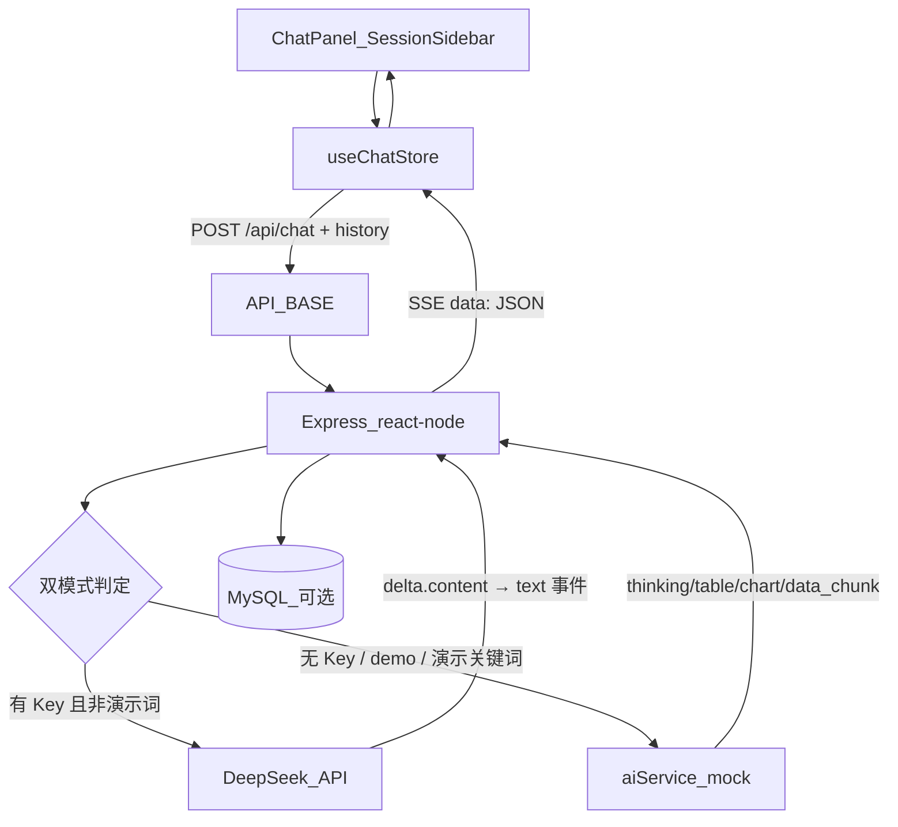

# AI 对话功能 — 面试版完整学习文档

> 与当前仓库代码同步（React 18 + TypeScript + Express SSE + DeepSeek / mock 双模式 + MySQL 可选持久化）  
> 用途：自学回顾、简历描述、面试深挖。**只写已实现能力。**

---

## 目录

1. [面试 60 秒叙事](#1-面试-60-秒叙事)
2. [项目总览](#2-项目总览)
3. [架构全景](#3-架构全景)
4. [类型系统](#4-类型系统)
5. [SSE 协议设计](#5-sse-协议设计)
6. [后端实现](#6-后端实现)
7. [前端实现](#7-前端实现)
8. [多会话架构](#8-多会话架构)
9. [性能与容错](#9-性能与容错)
10. [设计决策（面试重点）](#10-设计决策面试重点)
11. [本地运行与部署](#11-本地运行与部署)
12. [简历话术 + 高频追问](#12-简历话术--高频追问)
13. [附录：关键索引](#13-附录关键索引)

---

## 1. 面试 60 秒叙事

**你可以这样说：**

> 我独立做了一套产品内 AI 对话：前端多会话 + 流式输出，后端用 SSE。真问答走 DeepSeek（OpenAI 兼容流式 API，支持多轮 history、教育向 System Prompt）；结构化演示（思考过程、表格、图表、逐块追加）走本地 mock。密钥只放服务端。前端 Zustand 管多会话，每个会话独立 AbortController，切换会话不中断后台流。还做了空态快捷意图（错题讲解 / 推荐练习 / 改写讲解），对齐「生成类交互」。可部署到 GitHub Pages + Render。

**关键词清单（面试官爱记的）：** SSE · contentBlocks · AbortController Map · DeepSeek stream · mock 双模式 · 多轮 history · sanitizeStreamingMarkdown · Virtuoso · MySQL 降级

**一句话能怎么讲：** 不是调个 ChatGPT iframe，而是端到端把「流式协议 + 状态机 + 多会话 + 真模型/演示边界」做完整。

---

## 2. 项目总览

### 2.1 技术栈

| 层 | 技术 | 版本（约） |
|----|------|------------|
| 前端框架 | React | 18.3 |
| 类型 | TypeScript | 6.x |
| 构建 | Vite | 8.x |
| UI | Ant Design | 6.x |
| 状态 | Zustand | 5.x |
| Markdown | react-markdown + remark-gfm + rehype-highlight + rehype-katex | — |
| 图表 | ECharts（按需加载） | 6.x |
| 虚拟列表 | react-virtuoso | 4.x |
| 后端 | Express | 5.x |
| 真模型 | DeepSeek Chat Completions（stream） | — |
| 数据库 | MySQL（mysql2，可选） | — |
| 运行时 | tsx（dev）/ node dist（prod） | — |

### 2.2 文件清单（与代码对齐）

```
cms-react-ts/
├── src/
│   ├── types/chat.ts                      # 类型：contentBlocks / SSE / ChatSession
│   ├── store/useChatStore.ts              # 多会话 + SSE 循环 + history + 持久化
│   ├── api/chat.ts                        # 会话 CRUD；导出 API_BASE（VITE_API_BASE）
│   ├── vite-env.d.ts                      # VITE_API_BASE 类型
│   ├── utils/sanitizeStreamingMarkdown.ts # 流式未闭合围栏/公式修补
│   ├── pages/sbsjjc/                      # 页面编排 Sidebar + Panel
│   ├── components/Chat/
│   │   ├── SessionSidebar.tsx             # 会话列表
│   │   ├── ChatPanel.tsx                  # Virtuoso + 输入 + 教育快捷入口
│   │   ├── ChatMessageItem.tsx            # 气泡与内容分发
│   │   ├── ThinkingProcess.tsx            # 思考阶段 UI
│   │   ├── DataTableRenderer.tsx          # 表格 loading → data / chunk
│   │   ├── DataChartRenderer.tsx          # 图表 loading → data / chunk
│   │   ├── MarkdownRenderer.tsx / CodeBlock.tsx / ErrorBoundary.tsx
│   │   └── ...
│   └── router/index.tsx                   # 静态路由 /sbsjjc（不依赖远程菜单）
├── react-node/
│   └── src/
│       ├── index.ts                       # Express、CORS_ORIGIN、health
│       ├── db.ts                          # MySQL；失败则无持久化
│       ├── routes/chat.ts                 # POST /api/chat 双模式 SSE
│       ├── routes/sessions.ts             # 会话与消息 API
│       └── services/
│           ├── deepseekService.ts         # 真模型流式 + 多轮 + 教育 Prompt
│           └── aiService.ts               # mock generateStream / isMockDemoMessage
├── RENDER-部署清单.md
└── 岗位匹配度评估-AI问答.md
```

**一句话能怎么讲：** 前端负责体验与状态，后端负责协议与模型边界，类型层用 contentBlocks 统一「文本 + 表格 + 图表」。

---

## 3. 架构全景



### 3.1 双模式判定（后端）

`POST /api/chat`（`react-node/src/routes/chat.ts`）大致逻辑：

1. `demo === true` → **mock**
2. 未配置 `DEEPSEEK_API_KEY` → **mock**
3. `isMockDemoMessage(message)` 为真（如「分析销售数据」、图表/表格演示词、边界测试词）→ **mock**
4. 否则 → **DeepSeek**（只产出 `text` + `done`）

**一句话能怎么讲：** 真模型负责「能聊」；mock 负责「能演示结构化流与产品态」，面试里这叫会判断 AI 边界。

---

## 4. 类型系统

文件：`src/types/chat.ts`（后端 `aiService` 有对应 SSE 事件类型）。

### 4.1 内容块（核心）

| 类型 | 用途 |
|------|------|
| `TextContent` | Markdown 文本 |
| `TableContent` | 表格 columns + data |
| `ChartContent` | ECharts config |
| `MessageContent` | 以上联合类型 |

Assistant 消息用 `contentBlocks?: MessageContent[]`；`content` 字符串保留为纯文本兼容/拼接。

### 4.2 思考阶段

`ThinkingStageType`：`analyzing` | `searching` | `processing` | `generating` | `done`

### 4.3 SSE 事件类型

`thinking` · `text` · `table_loading` · `table_data` · `chart_loading` · `chart_data` · `data_chunk` · `done`

### 4.4 会话模型 `ChatSession`

除 messages 外关键字段：`isStreaming`、`draftInput`、`hasMoreOlder`、`isPaused`、`pausedMessage`、`resumeEventCount`（暂停续传，主要服务 mock 事件下标）。

**一句话能怎么讲：** 传输层是事件，渲染层是 contentBlocks，会话层是带流式元数据的 Session——三层解耦。

---

## 5. SSE 协议设计

### 5.1 请求

`POST /api/chat`  
`Content-Type: application/json`

| 字段 | 说明 |
|------|------|
| `message` | 当前用户输入（必填） |
| `sessionId` | 会话 id（可选，日志/关联） |
| `history` | `{ role, content }[]`，多轮上下文（DeepSeek 使用，最近约 20 条） |
| `demo` | `true` 强制 mock |
| `resumeFrom` | mock 续传：跳过前 N 个事件 |

### 5.2 响应

- `Content-Type: text/event-stream`
- 每帧：`data: {JSON}\n\n`
- DeepSeek 路径：连续 `text`，最后 `done`
- mock 路径：可含 thinking / table / chart / data_chunk

### 5.3 为何 JSON 而非纯文本 SSE？

同一连接要混文本与表格/图表元数据；前端用 `type` 分发。另有容错：非 JSON 行可降级当纯文本（mock 测试词可注入）。

### 5.4 一次性 vs 逐块

| 模式 | 事件 | 场景 |
|------|------|------|
| 一次性 | `table_data` / `chart_data` | 整表/整图到位 |
| 逐块 | `data_chunk`（`blockId` + `index`） | 表格逐行、图表逐系列，前端增量合并 |

**一句话能怎么讲：** 协议按「产品要展示的结构」设计，而不是按「模型吐什么字符串」设计。

---

## 6. 后端实现

### 6.1 入口 `react-node/src/index.ts`

- 监听 `process.env.PORT`（默认 3001）
- CORS：默认 `localhost:5173`，额外读 `CORS_ORIGIN`（逗号分隔，给 GitHub Pages）
- 路由：`/api/chat`、`/api/sessions`
- `GET /api/health` → `{ status, deepseek: boolean }`
- `initDB()` 失败则日志提示「无持久化模式」继续跑

### 6.2 聊天路由 `routes/chat.ts`

- 设 SSE 头，`Readable` pipe 到响应
- 客户端 `aborted` → `AbortController.abort()`，中止 DeepSeek fetch
- **mock**：`generateStream` 得事件数组，按类型 sleep 推送；支持 `resumeFrom`
- **DeepSeek**：`for await` `streamDeepSeekChat`，边收边推；**不**做事件下标续传

### 6.3 DeepSeek `services/deepseekService.ts`（已实现）

- URL：`https://api.deepseek.com/chat/completions`
- Header：`Authorization: Bearer ${DEEPSEEK_API_KEY}`
- Body：`model`（默认 `deepseek-chat`，可用 `DEEPSEEK_MODEL`）、`stream: true`
- `messages`：`system`（K12 教育向默认 Prompt，可被 `DEEPSEEK_SYSTEM_PROMPT` 覆盖） + `history` + 当前 `user`
- 解析上游 SSE：`choices[0].delta.content` → `{ type: 'text', data: { content } }`，结束 `{ type: 'done' }`

### 6.4 Mock `services/aiService.ts`

- `generateStream(message)`：按关键词走演示流 / 边界测试流
- `isMockDemoMessage(message)`：与演示关键词对齐，供路由在有 Key 时仍可走 mock
- 能力：思考阶段、Markdown 演示、销售数据完整报告、图表/表格、`data_chunk`、中断与坏数据测试

### 6.5 会话持久化 `routes/sessions.ts` + `db.ts`

- 会话 CRUD、消息分页、暂停状态
- MySQL 库 `cms_chat`；连不上则接口失败时前端需能降级（本地演示常依赖后端已启动）

**一句话能怎么讲：** 后端是「协议网关」——对上统一 SSE，对下可换 mock 或 DeepSeek，密钥与 Prompt 不出浏览器。

---

## 7. 前端实现

### 7.1 API 基址

`src/api/chat.ts`：

```ts
export const API_BASE =
  import.meta.env.VITE_API_BASE?.trim().replace(/\/$/, "") || "/api";
```

- 本地：`/api` → Vite 代理到 `localhost:3001`
- 生产：`VITE_API_BASE=https://xxx.onrender.com/api`

### 7.2 Zustand Store `useChatStore.ts`

**模块级闭包：**

- `abortControllers: Map<sessionId, AbortController>` — 多路 SSE 物理隔离
- `buildChatHistory(messages)` — 取非空、非 streaming 的 user/assistant，最近 20 条

**`sendMessage` 主流程：**

1. 截取 `history`（写入本轮消息之前）
2. 追加 user + assistant 占位（`isStreaming: true`）
3. `fetch(\`${API_BASE}/chat\`, { body: { message, sessionId, history } })`
4. 读 ReadableStream，按 `\n\n` 拆事件，`JSON.parse` 后更新对应 session 的 contentBlocks / thinkingStages
5. 批量 flush，减少 set 次数
6. `done` 或 abort 后 `persistMessages`

**暂停 / 继续：**

- `pauseStreaming`：abort 当前控制器，记录 `resumeEventCount`、`pausedMessage`
- `resumeStreaming`：再请求并带 `resumeFrom`（对 mock 有效）

### 7.3 页面编排 `pages/sbsjjc/index.tsx`

约 30 行：`initStore` + `SessionSidebar` + `ChatPanel`。路由在 `router/index.tsx` **静态注册** `/sbsjjc`，不依赖远程 CMS 菜单。

### 7.4 ChatPanel 快捷入口（教育向）

空态三个按钮（填入草稿 Prompt，用户可改完再发）：

1. 讲解这道错题  
2. 推荐 3 道同类练习  
3. 改成学生能懂的讲解  

对齐 JD「推荐 / 生成类交互」，仍走同一套 SSE。

### 7.5 渲染链路

- `ChatMessageItem`：按 block type 分发；`React.memo`
- `ThinkingProcess`：阶段列表 UI
- `DataTableRenderer` / `DataChartRenderer`：loading → 数据；chunk 模式增量；图表 `notMerge` 等细节
- `MarkdownRenderer` + `sanitizeStreamingMarkdown`：流式未闭合 \`\`\` / `$$` / `$` 自动补全，避免渲染崩

**一句话能怎么讲：** Store 吃协议，组件吃 contentBlocks；快捷入口只改「用户意图」，不另开一套接口。

---

## 8. 多会话架构

### 8.1 三个关键点

| 层次 | 做法 |
|------|------|
| 物理隔离 | `Map<sessionId, AbortController>` |
| 写入分离 | SSE 循环在 Store action 内，按 sessionId 更新，不绑死当前视图 |
| 视图指针 | `activeSessionId` 只决定渲染哪套 messages / draft |

### 8.2 切换会话时

- 后台 session A 仍可继续收流并写回 A 的 messages
- 侧栏可用流式状态指示
- 停止：`stopStreaming(id)` / `stopAllStreaming()`

### 8.3 刷新恢复

`initStore` → 拉 sessions → 选中会话拉消息分页；进行中的 SSE 不会跨刷新恢复（需重新发）。

**一句话能怎么讲：** 多会话的本质是「连接与状态按 id 隔离，UI 只是订阅器」。

---

## 9. 性能与容错

### 9.1 性能

- **Virtuoso** 虚拟列表，长会话不卡
- **React.memo** 消息气泡
- **批量更新** SSE 多事件合并再 set
- **ECharts 按需加载**
- CSS 过渡（表格/图表入场）— 体验向，面试点到即可

### 9.2 容错矩阵（摘要）

| 场景 | 策略 |
|------|------|
| SSE 非 JSON | 降级纯文本 |
| Markdown 未闭合 | `sanitizeStreamingMarkdown` |
| 表格/图残缺 | 防御性渲染 + ErrorBoundary |
| DeepSeek 失败 | 推一条错误 text + done |
| 客户端离开 | abort 上游 fetch |
| MySQL 挂 | 后端无持久化启动；会话刷新可能丢 |

### 9.3 mock 测试关键词（后端已实现）

中断 markdown、异常数据、loading 中断、JSON 容错、逐行/chunk、分析销售数据、markdown 演示、图表、对比、表格等。

**一句话能怎么讲：** 流式 UI 的难点不在「能显示字」，而在「半包、错包、未闭合、切换会话」仍稳定。

---

## 10. 设计决策（面试重点）

| 决策 | 原因 | 可追问点 |
|------|------|----------|
| 用 SSE 而非一次 JSON | 打字机体验、可中途停止 | 与 WebSocket 对比：单向服务器推、实现简单、够用 |
| contentBlocks 而非纯 Markdown | 表格/图表是一等公民 | 扩展新块类型只需加 type + 渲染器 |
| mock + DeepSeek 双模式 | 作品集可演示结构；线上可真聊 | 「会判断 AI」：模型不会稳定吐 ECharts JSON |
| 教育向 System Prompt | 对齐教培场景叙事 | 启发思考、拒绝对整题代写 |
| Key 只放服务端 | 防盗用 | Pages 静态站绝不能塞 Key |
| history 最近 20 条 | 控 token / 延迟 | 可改为按 token 截断 |
| 静态 `/sbsjjc` 路由 | 本地/Pages 不依赖内网菜单 API | 与动态菜单并存 |

---

## 11. 本地运行与部署

### 11.1 本地

```powershell
# 终端 1：前端
pnpm dev
# http://localhost:5173/?token=dev  → 再进 /sbsjjc

# 终端 2：后端
cd react-node
$env:DEEPSEEK_API_KEY="sk-..."   # 可选；不设则全走 mock
pnpm dev
# http://localhost:3001/api/health
```

### 11.2 环境变量

| 变量 | 端 | 作用 |
|------|----|------|
| `DEEPSEEK_API_KEY` | 后端 | 启用真模型 |
| `DEEPSEEK_MODEL` | 后端 | 默认 `deepseek-chat` |
| `DEEPSEEK_SYSTEM_PROMPT` | 后端 | 覆盖教育 Prompt |
| `CORS_ORIGIN` | 后端 | Pages 源，逗号分隔 |
| `VITE_API_BASE` | 前端构建 | 如 `https://xxx.onrender.com/api` |
| `PORT` | 后端 | Render 注入 |

### 11.3 推荐部署

- 前端：GitHub Pages（构建时带 `VITE_API_BASE`）
- 后端：Render Web Service，Root Directory = `react-node`
- 细节见 [`RENDER-部署清单.md`](./RENDER-部署清单.md)

Free Render 有冷启动；可先打 `/api/health` 预热。

---

## 12. 简历话术 + 高频追问

### 12.1 简历可写（示例）

- 独立实现 AI 对话端到端：SSE 流式协议、多会话（AbortController 隔离）、停止/暂停续传  
- 接入 DeepSeek 流式 API：多轮 history、教育向 Prompt；密钥服务端托管  
- 双模式：结构化 mock（思考/表格/图表/chunk）与真模型并存，可演示能力边界  
- 前端：Zustand + Virtuoso + Markdown/LaTeX/代码高亮；流式 Markdown 安全修补  
- 教育向快捷意图：错题讲解 / 推荐练习 / 讲解改写  
- （可选）GitHub + Pages 演示 + Render API 链接  

岗位匹配说明见 [`岗位匹配度评估-AI问答.md`](./岗位匹配度评估-AI问答.md)。

### 12.2 高频追问与答要点

**Q1：为什么用 SSE？**  
单向推送够用；HTTP 友好；比 WebSocket 简单；浏览器 `fetch` + ReadableStream 即可。

**Q2：多会话怎么做到切换不中断？**  
连接与状态按 `sessionId` 存在 Map/Store；UI 只切换 `activeSessionId`。

**Q3：真模型和 mock 如何分工？**  
有 Key 且非演示词 → DeepSeek 只出文本；演示词/无 Key → mock 出结构化事件。

**Q4：contentBlocks 解决什么问题？**  
让表格/图表与文本同一消息内有序渲染，而不是全塞进一个 Markdown 字符串硬解析。

**Q5：流式 Markdown 为什么会炸？你怎么修？**  
半包导致围栏/公式未闭合；`sanitizeStreamingMarkdown` 补全后再交给 rehype。

**Q6：如何防止 Key 泄露？**  
只放 Render/本地环境变量；前端只打自己的 `/api/chat`。

**Q7：多轮怎么做的？**  
发送前 `buildChatHistory`；后端拼 system + history + user。

**Q8：暂停续传怎么实现？**  
记录已消费事件数 `resumeEventCount`，mock 用 `resumeFrom` 切片；DeepSeek 路径不做事件级续传。

**Q9：虚拟列表怎么选？**  
`react-virtuoso`，流式追加 + `followOutput`，适合聊天场景。

**Q10：图表增量更新注意什么？**  
chunk 合并 series；ECharts `notMerge` 等策略避免旧 option 残留（实现见 DataChartRenderer）。

**Q11：和教培 JD 怎么贴？**  
流式对话 + 教育 Prompt + 快捷生成/推荐入口；诚实说未做完整作业批改系统。

**Q12：部署踩过什么坑？**  
Pages 相对路径 `/api` 404 → `VITE_API_BASE`；CORS 要放行 Pages；Render 冷启动。

**Q13：如何扩展新内容类型？**  
SSE 新 type → Store 解析进新 block → 新 Renderer；协议与 UI 同步演进。

**Q14：性能优化做过什么？**  
虚拟列表、memo、批量 set、图表懒加载。

**Q15：失败怎么降级？**  
解析失败当文本；模型错误写入气泡；DB 失败无持久化仍可聊。

---

## 13. 附录：关键索引

| 主题 | 位置 |
|------|------|
| 类型 | `src/types/chat.ts` |
| Store / SSE 循环 | `src/store/useChatStore.ts` → `sendMessage` / `pauseStreaming` / `resumeStreaming` |
| API_BASE | `src/api/chat.ts` |
| 快捷入口 | `src/components/Chat/ChatPanel.tsx` → `QUICK_ACTIONS` |
| Markdown 修补 | `src/utils/sanitizeStreamingMarkdown.ts` |
| 静态路由 | `src/router/index.tsx` → path `sbsjjc` |
| 双模式路由 | `react-node/src/routes/chat.ts` |
| DeepSeek | `react-node/src/services/deepseekService.ts` → `streamDeepSeekChat` |
| Mock | `react-node/src/services/aiService.ts` → `generateStream` / `isMockDemoMessage` |
| CORS / health | `react-node/src/index.ts` |
| 部署清单 | `RENDER-部署清单.md` |

---

*文档版本：与仓库当前 AI 问答实现同步。面试前建议本地跑通：无 Key 发「分析销售数据」看 mock；有 Key 发普通问题看 DeepSeek 流式。*
