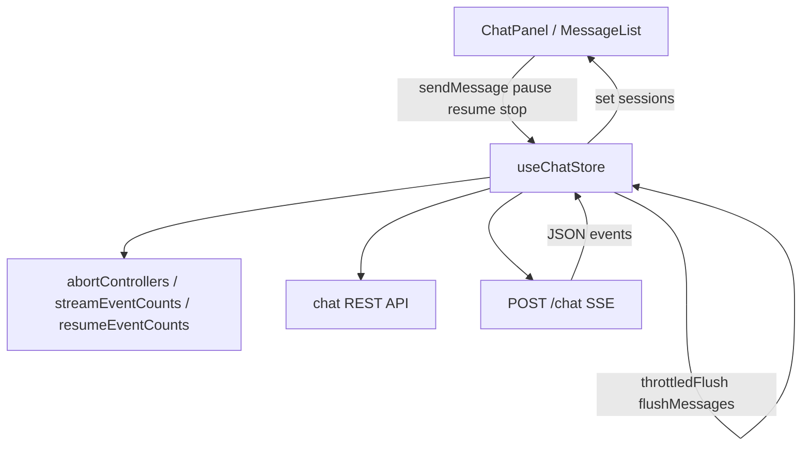
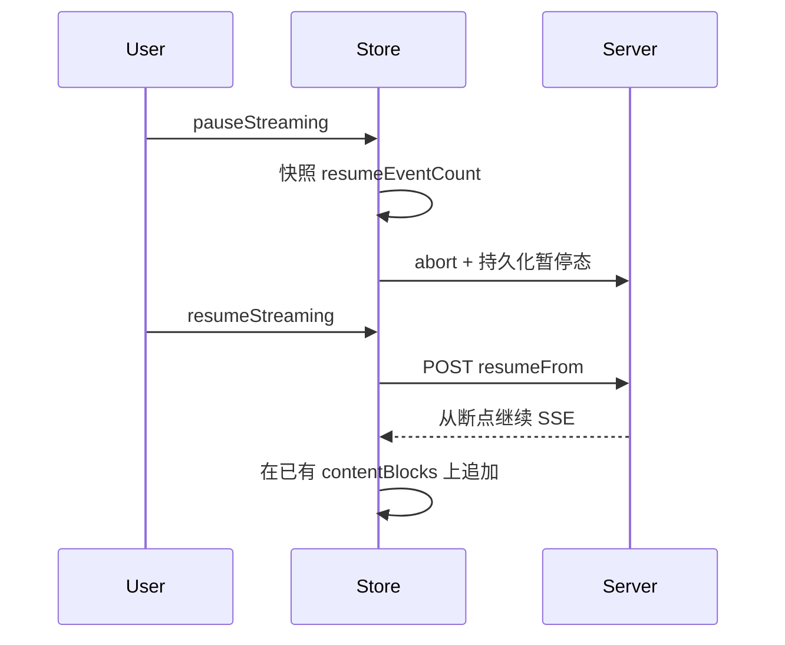

# useChatStore 面试讲解指南

对应源码：[`src/store/useChatStore.ts`](./src/store/useChatStore.ts)

> **文档分工：**  
> - 先讲「流怎么读」→ [`src/hooks/useStreamMessage.ts`](./src/hooks/useStreamMessage.ts)（教学 Hook，协议内核相同；可对照本文第 5.3 节）  
> - 本文讲「多会话产品态怎么管」→ Zustand Store（会话 CRUD、contentBlocks、节流、暂停续传、断线重试）  
> - **按时间线讲点发送之后代码怎么跑** → [`发消息全链路-面试口述.md`](./发消息全链路-面试口述.md)  
> - 端到端全景 / 简历话术 → [`AI对话功能-完整学习文档.md`](./AI对话功能-完整学习文档.md)  
> - 按功能点跟代码走 → [`AI对话功能-代码详解.md`](./AI对话功能-代码详解.md)

---

## 1. 一句话定位（开场 15 秒）

> 这是 AI 对话的 Zustand 状态中心：管多会话 CRUD、历史分页、SSE 流式消费、约 33ms 节流刷 UI、暂停续传和断线重试；不可序列化的 Abort/事件计数放模块级 Map，会驱动渲染的 sessions 进 Store。

**加分边界：** `useStreamMessage` 回答「单条流怎么读」；`useChatStore` 回答「多会话并发 + 结构化内容块 + 产品控制（暂停/停止/重连）怎么落地」。

---

## 2. 整体架构（口述时画这个）



**必须强调的三点：**

1. **唯一真相源：** `sessions[]` + `activeSessionId`
2. **按会话隔离取消：** `Map<sessionId, AbortController>`，切到别的会话**不杀**后台流
3. **流式中间态在闭包：** `contentBlocks` / `thinkingStages` 先在 `sendMessage` 局部累积，再经 `flushMessages` 写入 Store

对外能力一览：

| 能力 | 方法 | 面试一句话 |
|------|------|------------|
| 初始化 | `initStore` | 拉会话；失败本地降级 |
| 会话 CRUD | `create / delete / rename / setActive` | 乐观更新；删前 abort |
| 历史 | `loadMessages` / `loadMoreMessages` | 懒加载 + 前置去重 |
| 发消息 | `sendMessage` | 占位 → SSE → 节流 flush → 落库 |
| 流控制 | `pause / resume / stop / stopAll` | 暂停可续；停止清暂停态 |
| 刷 UI | `flushMessages` | 末条快路径；派生 `content` |
| 持久化 | `persistMessages` | 流结束 / 暂停 / 停止后同步后端 |

---

## 3. 模块级闭包（高频考点）

源码约 23–53 行。这些**不进 Zustand state**：

| 变量 | 作用 | 面试怎么说 |
|------|------|------------|
| `abortControllers` | 每个会话一把 AbortController | 不可序列化；devtools / persist 不该存 |
| `streamEventCounts` | 当前流已消费的 SSE 事件数 | 流式过程中实时更新；pause 时快照 |
| `resumeEventCounts` | 暂停点事件计数 | resume 时 body 带 `resumeFrom`，服务端跳过已推事件 |
| `buildChatHistory` | 最近 20 条纯文本多轮 | 排除空内容 / `isStreaming` 占位，控 token |
| `generateId` | `prefix_counter_timestamp` | 本地乐观 id，不依赖后端即时返回 |

**面试金句：** 「会驱动 UI 的进 Store；命令式句柄和流式中间计数用模块闭包——和 Hook 里 state vs ref 是同一原则，只是升级到模块级 Map。」

---

## 4. 会话与消息生命周期

### 4.1 `initStore`

- 调 `fetchSessions`；有数据则取第一条为 `activeSessionId`
- 无会话 → `createSession("新对话")`
- API 失败 → **本地降级**建空会话，保证 UI 可交互

**讲法：** 持久化是增强，不是硬依赖；前端有降级路径。

### 4.2 切换与懒加载

- `setActiveSession(id)`：只改指针；若该会话 `messages.length === 0` 且未在流式，则 `loadMessages`
- `loadMoreMessages`：按页拉更早消息，**前置合并**并用 `Set` 去重；`hasMoreOlder` / `isLoadingOlder` 防重复请求

**讲法：** 列表先轻量，点开再拉消息；上滑分页不打乱已渲染顺序。

### 4.3 会话 CRUD

- `createSession`：先调 API（失败仅打日志），再本地 `set` 并切为活跃
- `renameSession`：**乐观更新**标题，再异步同步后端
- `deleteSession`：**先 abort 该会话 SSE**，再删后端、再从 `sessions` 过滤；若删的是当前会话，切到剩余第一条或 `null`

### 4.4 草稿与落库

- `setDraftInput(sessionId, value)`：草稿挂在会话上，切换会话输入框不丢
- `persistMessages`：把内存中该会话 `messages` 整包交给 `saveMessagesAPI`；在流结束、暂停、停止时调用

---

## 5. `sendMessage`：按步骤讲（核心）

对应源码约 390–764 行。这是面试主戏。

### 5.1 前置：历史截取 + 双消息入列

```ts
const history = buildChatHistory(session.messages); // 先截，再追加本轮
// 追加 userMsg + assistantMsg（isStreaming: true, contentBlocks: []）
```

**为什么先 `buildChatHistory` 再 append？** 避免把刚插入的空 assistant 占位送进 history。

**为什么先插 assistant 占位？** 保证「正在流式的 assistant **永远是 messages 最后一条**」，后面 `flushMessages` 可以走 O(1) 快路径。

### 5.2 重试环（断线重连）

- `MAX_RETRIES = 3`，延迟 `[1000, 2000, 4000]`（指数退避）
- 重试前：清空局部 `contentBlocks` / `thinkingStages`，写入「正在重连」提示，短暂 `isReconnecting`
- `AbortError`（用户 pause/stop）→ **立刻 break**，不重试
- 网络 / HTTP 错误 → 进入下一次 attempt；最后一次失败写入错误文案

**讲法：** 区分「用户主动取消」和「传输失败」；只有后者才退避重试。

### 5.3 读流：与 Hook 同协议内核

```ts
fetch(`${API_BASE}/chat`, {
  method: "POST",
  body: JSON.stringify({ message, sessionId, history }),
  signal: controller.signal,
});
// reader.read → TextDecoder({ stream: true }) → lineBuffer 按 \n\n 拆事件
```

细节与 [`useStreamMessage`](./src/hooks/useStreamMessage.ts) 相同：UTF-8 半字符、`\n\n` 半包、`data:` / `[DONE]`。差异在载荷是 **JSON 事件**，不是纯文本拼接。

### 5.4 事件分发 → contentBlocks

| `event.type` | 写入哪里 | 要点 |
|--------------|----------|------|
| `thinking` | `thinkingStages` | 分析 / 检索等阶段，给 UI 展示思考过程 |
| `text` | `contentBlocks` 文本块 | 末块是 text 则**追加字符串**，否则 **push 新块** |
| `table_loading` / `chart_loading` | `pendingLoadingBlock` | 占位 loading（有数据到来时清掉） |
| `table_data` / `chart_data` | 整块 table / chart | 一次推完整结构 |
| `data_chunk` | 按 `blockId` 追加行/系列 | 大表大图分片；`index===0` 建块，后续 merge |
| `done` | 仅计数 | 协议结束信号之一 |

JSON `parse` 失败时：**兜底当纯文本 push**，避免整条流白屏。

每处理完一批事件：`sseEventCount++` 写入 `streamEventCounts`，供 pause 快照。

### 5.5 节流刷 UI：`throttledFlush`

```ts
const FLUSH_INTERVAL_MS = 33; // ~30fps
// 距上次 flush ≥ 33ms → 立刻 flushMessages
// 否则 pendingFlush = true；流结束再补刷一次
```

**面试金句：** 「模型吐 token 可能远快于帧率；节流是控 React 提交频率，不是丢数据——数据在闭包数组里，丢的是中间帧的渲染次数。」

### 5.6 收尾

重试环结束后（若会话还在）：

1. `flushMessages(..., isStreaming: false)`
2. `persistMessages(sessionId)`
3. `finally` 里 `abortControllers.delete(sessionId)`

---

## 6. `flushMessages` 性能设计

源码约 329–387 行。

1. **快路径：** `messages[last].id === localId && role === assistant` → 只替换最后一项  
2. **慢路径（安全带）：** `findIndex` 按 id 更新（防极端情况下不变式被破坏）  
3. **派生 `content`：** 把 text 类型 block 的 `text` join 成字符串，兼容只读 `content` 的旧渲染路径  
4. 同步更新会话级 `isStreaming`、`updatedAt`

**面试金句：** 「高频路径用不变式换 O(1)；不变式由 sendMessage『assistant 永远垫底』保证；再留 findIndex 兜底。」

---

## 7. 暂停 / 继续 / 停止（差异必问）

| API | 行为 | 面试一句 |
|-----|------|----------|
| `pauseStreaming` | abort + 把 `streamEventCounts` 快照到 `resumeEventCounts` + `isPaused` + 持久化暂停态与 `pausedMessage` | 保留半成品，可续 |
| `resumeStreaming` | 从最后一条 assistant 的 `contentBlocks` 续写；body 带 `resumeFrom`；清后端暂停态 | 服务端跳过已消费事件，客户端不重复渲染 |
| `stopStreaming` | abort + 清两份计数 + `isPaused=false` + 落库 | 本轮结束，不续 |
| `stopAllStreaming` | Map 里全部 abort + 全员 `isStreaming=false` | 卸载 / 全局清理 |

**`pausedMessage` 干什么？** 暂停时记下触发本轮的用户原文；继续时还要带同一 `message` 让服务端从断点后续推。

**刷新后 resume？** 计数优先读内存 Map，否则读 session 上恢复的 `resumeEventCount`（暂停时已通过 `updatePauseStateAPI` 落库）。



---

## 8. 设计决策清单（对着简历讲）

| 决策 | 理由 |
|------|------|
| Zustand 而非 Context | 流式高频 `set`；组件可按 selector 订阅，避免整树 Context 重渲；`devtools` 可调 |
| contentBlocks 而非纯字符串 | 文本 + 表格 + 图表混排；块级流式追加（尤其 `data_chunk`） |
| 节流 33ms | 对齐约 30fps；数据在闭包，渲染降频 |
| history 上限 20 | 控 token / 延迟，与多轮体验折中 |
| AbortController Map | 多会话并发；切会话不中断后台流 |
| 模块闭包存 controller / 计数 | 不可序列化；不进 persist；不污染可观察 state |
| 乐观更新 + API 降级 | 创建/重命名先本地；init 失败仍可聊 |

---

## 9. 3 分钟口述脚本（可直接背）

1. **定位：** 我用 Zustand 做多会话聊天 Store：会话列表、当前会话、每条消息的 contentBlocks 和思考阶段都在这里。
2. **发消息：** 先截最近 20 条 history，再插入 user + 流式 assistant 占位；POST `/chat` 收 SSE。
3. **读流：** fetch + ReadableStream + 行缓冲，和教学 Hook 一样；差别是 `data:` 里是 JSON，按 type 更新 thinking / text / table / chart。
4. **性能：** 内容先累在闭包数组，约 33ms 节流一次 `flushMessages`；assistant 保证在末尾，更新走 O(1)。
5. **控制：** 每个 sessionId 一把 AbortController。暂停会记下已消费事件数，继续时带 `resumeFrom`；停止则清暂停态并落库。断线最多重试 3 次指数退避，用户 abort 不重试。
6. **收尾：** 流结束把 `isStreaming` 置 false 并 `persistMessages`。

---

## 10. 高频追问速答

| 问题 | 答法 |
|------|------|
| Abort 和 pause 有何区别？ | 都是 `abort()` 掐连接。pause 额外保存事件计数 + `isPaused` + `pausedMessage`，允许 resume；stop 清计数并不再续。 |
| 重试会不会丢已显示内容？ | 重试会清空局部 blocks 并提示重连，等于从本轮重新拉（当前实现偏「整轮重来」）。可主动说：若要「断点续传式重试」应复用 pause 的 `resumeFrom` 思路。 |
| 为什么 history 不含当前 user？ | 当前句放 `message` 字段；history 是「不含本轮」的上文，避免重复。 |
| 切会话会停流吗？ | 不会。controller 按 sessionId 隔离；后台会话继续 flush 自己的 messages。 |
| 刷新页面后还能继续暂停的回复吗？ | 暂停态和 `resumeEventCount` 会走 `updatePauseStateAPI`；恢复后优先内存，否则用 session 上的计数。 |
| JSON 解析失败怎么办？ | catch 里当纯文本 push，保证至少有可读内容。 |
| 为何不用 EventSource？ | 要 POST + JSON body（message / history / resumeFrom）；EventSource 基本只适合 GET。 |
| 为何不用 WebSocket？ | 本场景是单向服务端推送；SSE over HTTP 更简单，代理友好。 |
| flush 快路径为何安全？ | sendMessage / resume 都约定正在更新的 assistant 是最后一条；破坏时走 findIndex。 |
| 和 useStreamMessage 差在哪？ | 协议内核相同；Store 多了会话维度、JSON 多类型事件、节流、暂停续传、重试、持久化。 |

---

## 11. 模拟面试问答（口语版）

**Q：这个 Store 解决什么问题？**

A：产品级 AI 对话不止「显示一段流式字」。要多会话、可切换、后台继续生成、结构化输出（思考过程、表、图）、暂停后续写、断线重试、消息落库。这些状态和控制流集中在 `useChatStore`。

**Q：为什么 AbortController 不用 state？**

A：它是命令式句柄，改它不需要触发渲染，也不能被 JSON 序列化。我用模块级 `Map<sessionId, AbortController>`，pause/stop/delete 时按 id 取出 `abort()`。原则和 Hook 里用 ref 一样，只是支持多连接。

**Q：流式内容为什么不直接每次 set 拼接字符串？**

A：两层原因。一是内容不是纯文本，是 contentBlocks（text/table/chart）。二是 token 频率可能高于帧率，我在闭包里同步累积，再 33ms 节流 `flushMessages`，减少 React 提交次数，同时结束时补刷 `pendingFlush`，保证最终态不丢。

**Q：暂停续传怎么保证不重复字？**

A：客户端边收边数 SSE 事件，pause 时快照计数；resume 请求带 `resumeFrom`，服务端从该序号之后继续推。客户端从已有 contentBlocks 上追加，而不是清空重来。

**Q：有什么你会主动改进的？**

A：send 与 resume 里 SSE 解析 / handleDataChunk / throttledFlush 有重复，可抽成共享的 `consumeSSE`；网络重试目前整轮重置，可改成带 `resumeFrom` 的断点续传；生产可去掉 `console.log(lineBuffer)` 这类调试输出。

---

## 12. 对照源码速查（行号区间）

| 区间（约） | 职责 |
|------------|------|
| 23–53 | 模块闭包：history 构建、Abort Map、事件计数、id 生成 |
| 57–101 | Store 类型契约 |
| 124–158 | `initStore` 与本地降级 |
| 162–222 | `loadMessages` / `loadMoreMessages` |
| 226–325 | 持久化、会话 CRUD、草稿 |
| 329–387 | `flushMessages` 快/慢路径 |
| 390–764 | `sendMessage`（主路径：重试 + SSE + 节流） |
| 766–800 | `pauseStreaming` |
| 802–1035 | `resumeStreaming` |
| 1037–1066 | `stopStreaming` / `stopAllStreaming` |

类型定义见 [`src/types/chat.ts`](./src/types/chat.ts)：`ChatMessage` / `MessageContent` / `SSEEventType` / `ChatSession`。

---

## 13. 复习检查清单

- [ ] 能用 15 秒说清 Store 职责，并对比 useStreamMessage
- [ ] 能手画：UI → Store → Map / REST / SSE → flush → UI
- [ ] 能解释模块闭包 vs Zustand state 的划分原则
- [ ] 能按步骤讲 sendMessage（history → 占位 → 读流 → 事件 → 节流 → 落库）
- [ ] 能说清 pause / resume / stop 三者差异与 `resumeFrom`
- [ ] 能解释 flush 快路径与 33ms 节流
- [ ] 能答：切会话为何不中断后台流；Abort 为何不重试
