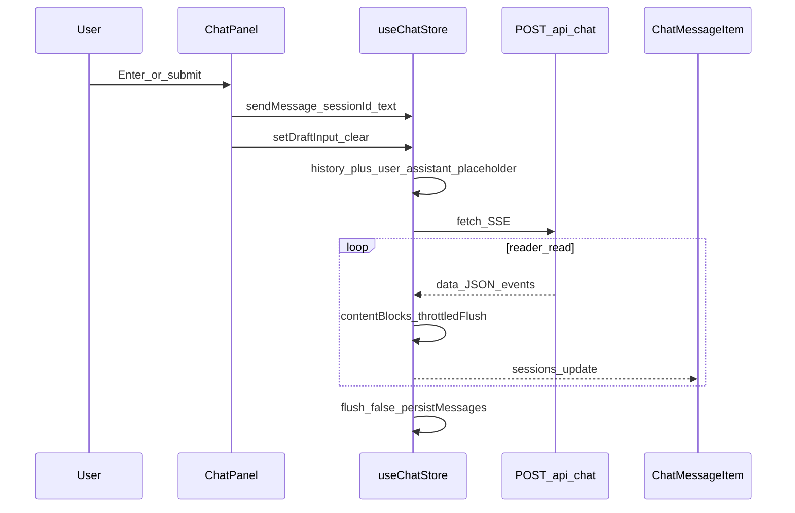

# 发消息全链路 — 面试口述指南

> **文档分工：**  
> - 本文按**时间线**讲：点发送之后代码从哪跑到哪  
> - Store 设计深挖 → [`useChatStore-面试讲解.md`](./useChatStore-面试讲解.md)  
> - 端到端全景 / 简历话术 → [`AI对话功能-完整学习文档.md`](./AI对话功能-完整学习文档.md)  
> - 按功能点跟代码走 → [`AI对话功能-代码详解.md`](./AI对话功能-代码详解.md)

对应主路径：

| 环节 | 文件 / 函数 |
|------|-------------|
| UI 触发 | [`ChatPanel.tsx`](./src/components/Chat/ChatPanel.tsx) → `handleSend` |
| 状态与读流 | [`useChatStore.ts`](./src/store/useChatStore.ts) → `sendMessage` / `flushMessages` |
| 后端 SSE | [`react-node/src/routes/chat.ts`](./react-node/src/routes/chat.ts) |
| 气泡渲染 | [`ChatMessageItem.tsx`](./src/components/Chat/ChatMessageItem.tsx) → Markdown / 表 / 图 / Mermaid |

---

## 0. 一句话开场（10 秒）

> 用户点发送后，UI 只调 Store 的 `sendMessage`；Store 先乐观插入 user + 流式 assistant 占位，再 POST 拉 SSE；边解析 JSON 事件边往闭包里的 contentBlocks 累加，约 33ms 节流 `flushMessages` 刷 UI；流结束后落库。渲染走 Virtuoso → ChatMessageItem 按块类型分发。

---

## 1. 总览图（口述时先画）

**四个文件名必须能脱口而出：** `ChatPanel` → `useChatStore.sendMessage` → `routes/chat.ts` → `ChatMessageItem`。

---

## 2. 七段时间线（按执行顺序）

### 第 1 段：UI 入口（约 20 秒）

文件：[`src/components/Chat/ChatPanel.tsx`](./src/components/Chat/ChatPanel.tsx)

1. 底部 `form` 的 `onSubmit` → `handleSubmit` → `e.preventDefault()` → `handleSend`
2. `handleSend` 守卫：没有 `activeSessionId`、输入为空、或当前会话 `isStreaming` → 直接 return
3. 调用 `sendMessage(activeSessionId, inputValue)`（**不 await**，发完立刻往下走）
4. 紧接着 `setDraftInput(activeSessionId, "")` 清空草稿，输入框变空
5. 列表侧：`Virtuoso` 的 `data={messages}`，`itemContent` 渲染 `ChatMessageItem`；Store 一 `set`，末条 assistant 就会重绘

**面试金句：** 「UI 只负责触发和订阅；发消息业务全在 Store。」

---

### 第 2 段：Store 发消息前置（约 40 秒）

文件：[`src/store/useChatStore.ts`](./src/store/useChatStore.ts) → `sendMessage`

1. `getSession(sessionId)` + `content.trim()` 校验
2. **先** `buildChatHistory(session.messages)`：最近 20 条 user/assistant 纯文本，排除空内容和 `isStreaming` 占位  
   ——必须在 append **之前**截，否则会把本轮空的 assistant 塞进 history
3. 构造两条消息：
   - `userMsg`：用户原文
   - `assistantMsg`：`id = localId`，`content: ""`，`contentBlocks: []`，`thinkingStages: []`，`isStreaming: true`
4. `set`：把两条 append 进该会话 `messages`，会话级 `isStreaming: true`，更新 `updatedAt`
5. **不变式：** 正在流式的 assistant **永远是 messages 最后一条** → 后面 `flushMessages` 可以走「只改 last」的 O(1) 快路径

此时界面上已经出现：用户气泡 + 空的 AI 气泡（可带思考区/光标），请求还没回来。

---

### 第 3 段：建立 SSE（约 30 秒）

仍在 `sendMessage`：

1. 在重试环**外**准备本轮局部状态：`contentBlocks`、`thinkingStages`、`blockIdMap`、节流用的 `lastFlushTime` / `pendingFlush`
2. `MAX_RETRIES = 3`，延迟 `1s / 2s / 4s`；仅网络错误重试，`AbortError` 立刻退出
3. `const controller = new AbortController()` → `abortControllers.set(sessionId, controller)`（**按会话一把刀**，切会话不杀后台流）
4. `fetch(\`${API_BASE}/chat\`, { method: "POST", body: JSON.stringify({ message, sessionId, history }), signal: controller.signal })`
5. `response.body.getReader()` + `TextDecoder({ stream: true })` + `lineBuffer`，按 SSE 空行 `\n\n` 切完整事件，半包留到下次

**面试金句：** 「不用 EventSource，因为要 POST 带 message / history / resumeFrom。」

---

### 第 4 段：后端怎么回（约 30 秒）

文件：[`react-node/src/routes/chat.ts`](./react-node/src/routes/chat.ts)

1. `POST /` 读 body：`message`、`sessionId`、`history`、`resumeFrom`、`demo`
2. 分流：`useMock = demo === true || !hasDeepSeekKey() || isMockDemoMessage(trimmed)`
3. `setupSseHeaders`：`Content-Type: text/event-stream`，关缓冲
4. **Mock：** `generateStream(message)` 得到事件数组；若有 `resumeFrom` 则 `slice` 掉已消费事件；循环 `pushEvent` → `data: ${JSON.stringify(event)}\n\n`
5. **DeepSeek：** `streamDeepSeekChat` 读模型流，把 delta 转成前端认识的 `text` 等 SSE 事件再推

关键词如「mermaid / 分析销售数据」会走 mock 结构化演示；无 Key 时整站默认 mock。

---

### 第 5 段：前端吃事件 + 节流刷 UI（主戏，约 60 秒）

对每个完整 `data:` 行（跳过 `[DONE]`）：

1. `JSON.parse(payload)` → `{ type, data }`；parse 失败则当纯文本 push 进 `contentBlocks`（容错）
2. `switch (event.type)`：

| type | 写入哪里 | 要点 |
|------|----------|------|
| `thinking` | `thinkingStages` | 分析 / 检索等阶段文案 |
| `text` | `contentBlocks` | 末块是 text → 字符串追加；否则 push 新 text 块 |
| `table_loading` / `chart_loading` | `pendingLoadingBlock` | 骨架占位，有数据时清掉 |
| `table_data` / `chart_data` / `data_chunk` | table/chart 块 | `blockId` 建块或逐行/逐系列 merge |
| `done` | 仅计数 | 协议结束信号之一 |

3. 每处理完一批有更新 → `throttledFlush`（间隔约 **33ms ≈ 30fps**）  
   → `flushMessages(sessionId, localId, contentBlocks, thinkingStages, true)`  
   → 快路径改 `messages[last]`，同步派生 `content`（text 块 join），会话 `isStreaming` 保持 true
4. 同时 `sseEventCount++` 写入模块级 `streamEventCounts`，供 **pause** 时快照成 `resumeFrom`

**面试金句：** 「数据在闭包里同步累加；节流只降 React 提交频率，不丢 token。」

---

### 第 6 段：渲染落地（约 40 秒）

1. Zustand `set` → 订阅了 `sessions` / 当前 session 的 `ChatPanel` 重渲染
2. `Virtuoso` 的 `data={messages}` 更新末项 → [`ChatMessageItem`](./src/components/Chat/ChatMessageItem.tsx)
3. 若有 `thinkingStages` → `ThinkingProcess`（思考过程 UI）
4. 若有 `contentBlocks`，按 `block.type` 分发：
   - `text` → [`MarkdownRenderer`](./src/components/Chat/MarkdownRenderer.tsx)（remark-gfm / KaTeX / highlight；流式时 `sanitizeStreamingMarkdown` 补未闭合围栏）
   - `language-mermaid` 代码块 → [`MermaidBlock`](./src/components/Chat/MermaidBlock.tsx)：**流式中只展示源码，结束后才 `mermaid.render`**
   - `table` → `DataTableRenderer`；`chart` → `DataChartRenderer`（ECharts）
5. `isStreaming` 时 Markdown 旁有脉冲光标

无 `contentBlocks` 的旧消息走 `message.content` 纯文本 Markdown 兼容路径。

---

### 第 7 段：收尾（约 20 秒）

1. `reader` 读完 / 收到结束 → 退出重试环（成功 `break`；用户 abort 也 `break`；网络错才退避重试）
2. `flushMessages(..., isStreaming: false)` 关掉气泡与会话的流式标记
3. `persistMessages(sessionId)` → `saveMessagesAPI` 把内存消息落后端
4. `finally`：`abortControllers.delete(sessionId)`

**暂停 / 停止 / 继续（追问各一句）：**

| API | 行为 |
|-----|------|
| `pauseStreaming` | `abort` + 把 `streamEventCounts` 快照到 `resumeEventCounts` + `isPaused` + 持久化暂停态 |
| `stopStreaming` | `abort` + 清暂停计数 + 落库，**不续** |
| `resumeStreaming` | 用已有 `contentBlocks` 续写；body 带 `resumeFrom`，服务端跳过已推事件 |

---

## 3. 2～3 分钟连贯口述稿（可直接背）

可以这样说：

> 用户在 ChatPanel 里回车，表单 submit 进 `handleSend`。校验通过后调 Zustand 的 `sendMessage`，并马上清空草稿。  
>  
> Store 里先按最近 20 条截多轮 history，再乐观插入一条 user 和一条 `isStreaming` 的 assistant 占位，保证 assistant 永远在 messages 末尾。这时 UI 已经能看到两条气泡。  
>  
> 然后按 sessionId 建 AbortController，POST `/api/chat`，用 ReadableStream 读 SSE。后端无 Key 或命中演示关键词就走 mock 的 `generateStream`，否则走 DeepSeek，统一推 `data: JSON\n\n`。  
>  
> 前端按 `\n\n` 拆事件，JSON 解析后按 type 写 thinking 或 contentBlocks；大约 33 毫秒节流一次 `flushMessages`，只改最后一条 assistant，驱动 Virtuoso 重绘。ChatMessageItem 再按块类型渲染 Markdown、表格、ECharts 或 Mermaid。  
>  
> 流结束把 `isStreaming` 置 false，并 `persistMessages` 落库。暂停会记下已消费事件数以便 `resumeFrom` 续传；停止则清暂停态不再续。

---

## 4. 高频追问速答

| 问题 | 答法 |
|------|------|
| 为什么先 `buildChatHistory` 再 append？ | 当前 user 放 `message` 字段；history 是「不含本轮」的上文。若先插入空 assistant 再截，会把占位脏数据送进模型。 |
| 为什么要 33ms 节流？ | Token 可能远快于帧率；闭包里数据不丢，只减少 React `set` 次数，对齐约 30fps。结束时若有 `pendingFlush` 再补刷一次。 |
| AbortController 为什么用 Map？ | 多会话并发；按 `sessionId` 隔离取消。切到别的会话不 `abort` 后台流。不可序列化，不进 Zustand state。 |
| mock 和 DeepSeek 怎么选？ | `demo`、无 API Key、或 `isMockDemoMessage`（如分析销售数据 / mermaid）→ mock；否则真模型。协议都是同一套 SSE JSON。 |
| Mermaid 为什么流式时不画？ | 半截语法会狂报错；`isStreaming` 时只展示源码，结束后懒加载 `mermaid.render`，失败回退源码。 |
| `flushMessages` 快路径安全吗？ | `sendMessage` / `resume` 约定正在更新的 assistant 是最后一条；破坏时用 `findIndex` 安全带。 |
| 发消息为什么不 await？ | UI 发完立刻清输入框；流式是长任务，结果靠 Store 订阅驱动，不必阻塞 `handleSend`。 |

---

## 5. 模拟面试（口语版）

**Q：从用户点发送开始，代码怎么走？**

A：ChatPanel 的 `handleSend` → `useChatStore.sendMessage`。Store 先截 history、插入 user 和流式 assistant，再 fetch SSE。读流解析 JSON 事件，累加 contentBlocks，节流 flush 更新末条消息。Virtuoso 重绘 ChatMessageItem，按 text/table/chart 渲染。结束 flush false 并 persist。后端在 `routes/chat.ts` 按 mock 或 DeepSeek 推同一套事件。

**Q：用户已经看到回复在涨，数据存在哪？**

A：两层：闭包里的 `contentBlocks` 是同步真相源；周期性 `flushMessages` 拷贝进 Zustand 的 `sessions[].messages`，组件订阅后者。不能每 token 都只靠 React state 拼接，否则异步批处理容易乱、也太重。

**Q：中途点暂停呢？**

A：`pauseStreaming` 对应该会话的 AbortController 调 abort，把当前 SSE 事件计数存起来并标记 `isPaused`。继续时 `resumeStreaming` 带着 `resumeFrom` 再 POST，服务端跳过已推事件，客户端在已有 blocks 上追加。

---

## 6. 复习检查清单

- [ ] 能按时间线讲完七段，不跳文件
- [ ] 能手画：Panel → Store → fetch SSE → flush → MessageItem
- [ ] 能说出为何 history 先截、为何 assistant 垫底、为何 33ms 节流
- [ ] 能区分 pause / stop / resume
- [ ] 能说出 mock vs DeepSeek 的分流条件
- [ ] 能点名四个文件：`ChatPanel`、`useChatStore`、`chat.ts`、`ChatMessageItem`
